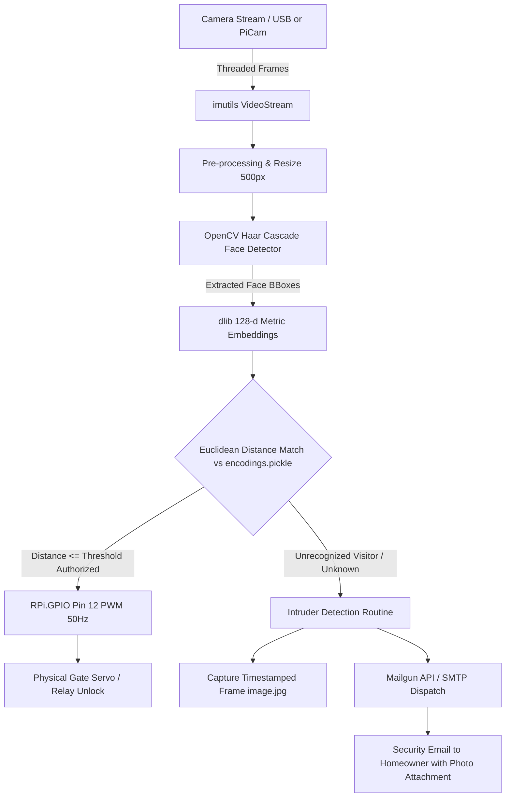

# Smart Gate Controller: IoT & Automated Facial Recognition Access Control System

[](LICENSE)
[](https://www.python.org/)
[](https://www.raspberrypi.com/)
[](https://opencv.org/)
[](http://dlib.net/)

> **Undergraduate Capstone Engineering Project**  
> **Author:** Jeff Tarimo  
> **Degree:** B.Sc. in Electronics and Computer Engineering  
> **Department:** Department of Telecommunication and Information Engineering  
> **Institution:** Jomo Kenyatta University of Agriculture and Technology (JKUAT)  
> **Full Thesis:** [FINAL REPORT.pdf](FINAL%20REPORT.pdf)

---

## 📌 Project Overview

The **Smart Gate Controller** is an embedded edge-deployed access control system engineered on a **Raspberry Pi 4 Model B**. It automates physical residential and commercial gate security by pairing low-latency computer vision with physical electromechanical actuation.

Using OpenCV Haar Cascades and deep metric facial embeddings via `dlib` (128-dimensional biometric vectors), the system detects, crops, and authenticates authorized occupants in real time. Upon verification, it drives a physical gate lock via a **50Hz PWM servo/relay signal on GPIO pin 12**. When an unrecognized individual is detected, the system automatically captures a high-resolution snapshot and dispatches an **instant security alert email** containing the timestamped intruder image.

---

## 📸 Hardware Prototype & Live Output

| Hardware Setup (Raspberry Pi 4 + Camera) | Real-Time Live Recognition Output |
| :---: | :---: |
|  |  |
| *Raspberry Pi 4 Model B with USB Camera & Breadboard Actuation Circuitry* | *Real-time facial detection bounding box and authorized identity classification* |

🎬 **Live Demonstration Video:** Check out [`WhatsApp Video 2024-12-16 at 17.21.58.mp4`](WhatsApp%20Video%202024-12-16%20at%2017.21.58.mp4) for a live operational demonstration of occupant detection and gate actuation.

---

## ⚙️ System Architecture



---

## 🚀 Key Features

- **Edge-Deployed Face Recognition:** Runs entirely on-device on the Raspberry Pi without relying on third-party cloud computer vision APIs, ensuring low latency and privacy.
- **Deep 128-Dimensional Metric Embeddings:** Uses a deep ResNet model (`dlib`/`face_recognition`) to map facial features into a 128-dimensional vector space, measuring Euclidean distance between known profiles.
- **Hardware Actuation via PWM:** Direct hardware-level interface utilizing `RPi.GPIO` to generate a 50Hz Pulse-Width Modulation (PWM) signal driving servo motors and electromagnetic gate latch relays.
- **Automated Security & Intruder Alerts:** When an unknown face lingers in the detection zone, the system saves a timestamped snapshot (`image.jpg`) and dispatches a security alert email via Mailgun API / SMTP.
- **Threaded Video Stream Optimization:** Built using `imutils` threaded video capture to bypass I/O blocking and achieve smooth real-time inference on ARM Cortex-A72.

---

## 🛠️ Hardware Requirements & Pinout

### Component Bill of Materials (BOM)
1. **Raspberry Pi 4 Model B** (2GB, 4GB, or 8GB RAM) running Raspberry Pi OS (Linux).
2. **Camera Sensor:** USB 1080p Webcam or 5MP/8MP Raspberry Pi Camera Module (CSI).
3. **Actuation Mechanism:** TowerPro SG90 / MG996R 180° Servo Motor or 5V Single-Channel Relay Module.
4. **Power Supply:** 5V 3A USB-C Power Adapter for the Raspberry Pi + optional external 5V rail for servo/locks.
5. **Jumper Wires & Breadboard.**

### Pinout Configuration (Physical Board Pin numbering)
| Raspberry Pi Physical Pin | Function / Target | Description |
| :--- | :--- | :--- |
| **Pin 12 (GPIO 18)** | **PWM Signal (50Hz)** | Servo Control Lead / Relay Trigger Pin |
| **Pin 2 or 4** | **5V DC Power** | External Logic / Module VCC |
| **Pin 6 or 14** | **GND** | System Common Ground |

---

## 📂 Project Directory Structure

```text
smartGateController/
├── dataset/                            # Training directory grouped by identity
│   ├── Tarimo/                         # Training images for occupant Tarimo
│   └── Elon/                           # Training images for occupant Elon
├── photo/                              # Project media assets
│   ├── webcamandRPi4.JPG               # Hardware prototype image
│   └── screenshot.png                  # Detection output screenshot
├── encodings.pickle                    # Serialized 128-d biometric embeddings model
├── haarcascade_frontalface_default.xml # OpenCV Haar feature-based cascade classifier
├── headshots.py                        # Capture dataset photos from USB camera
├── headshots_picam.py                  # Capture dataset photos from PiCamera
├── train_model.py                      # Computes embeddings & serializes encodings.pickle
├── facial_req.py                       # Real-time face detection & recognition stream
├── face.py                             # Real-time recognition + physical GPIO gate actuation
├── facial_req_email.py                 # Recognition + automated intruder email notification
├── send_test_email.py                  # Script to test email alert connectivity
├── cam_test.py                         # Test video stream feed and frame-rate
├── WhatsApp Video 2024-12-16...mp4     # Operational demonstration video
├── FINAL REPORT.pdf                    # Complete engineering thesis & report
└── LICENSE                             # Open-source license
```

---

## 💻 Installation & Setup

### 1. Prerequisites (Raspberry Pi OS)
Ensure your Raspberry Pi packages are up to date and system build tools are installed:

```bash
sudo apt update && sudo apt upgrade -y
sudo apt install -y build-essential cmake pkg-config
sudo apt install -y libjpeg-dev libtiff5-dev libjasper-dev libpng-dev
sudo apt install -y libavcodec-dev libavformat-dev libswscale-dev libv4l-dev
sudo apt install -y libxvidcore-dev libx264-dev
sudo apt install -y libfontconfig1-dev libcairo2-dev
sudo apt install -y libgdk-pixbuf2.0-dev libpango1.0-dev
sudo apt install -y libgtk2.0-dev libgtk-3-dev
sudo apt install -y libatlas-base-dev gfortran
sudo apt install -y python3-dev python3-pip
```

### 2. Clone the Repository
```bash
git clone https://github.com/Tarimo077/smartGateController.git
cd smartGateController
```

### 3. Install Python Dependencies
```bash
pip3 install opencv-python dlib face_recognition imutils requests RPi.GPIO
```

> **Tip:** If compiling `dlib` on Raspberry Pi, increase swap space temporarily to prevent out-of-memory errors:
> ```bash
> sudo nano /etc/dphys-swapfile  # Set CONF_SWAPSIZE=2048
> sudo /etc/init.d/dphys-swapfile restart
> ```

---

## 🧪 Usage & Execution Workflow

### Step 1: Capture Face Training Dataset
Create a folder for the individual inside `dataset/<Name>` and run:
```bash
python3 headshots.py
```
- Press `<SPACE>` to capture training frames.
- Press `<Q>` to exit once you have 10–20 varied angles.

### Step 2: Train the Facial Biometric Model
Run the feature extraction pipeline:
```bash
python3 train_model.py
```
This iterates over all images in `dataset/`, computes the 128-dimensional facial encodings using `dlib`, and writes them to `encodings.pickle`.

### Step 3: Configure Security Email Credentials (Optional)
In `facial_req_email.py`, update your Mailgun domain or SMTP credentials:
```python
def send_message(name):
    return requests.post(
        "https://api.mailgun.net/v3/YOUR_DOMAIN_NAME/messages",
        auth=("api", "YOUR_API_KEY"),
        files=[("attachment", ("image.jpg", open("image.jpg", "rb").read()))],
        data={
            "from": "SmartGate Security <security@yourdomain.com>",
            "to": ["your-email@gmail.com"],
            "subject": f"Security Alert: Visitor Detected",
            "html": f"<h3>Access Alert: {name} is at your gate.</h3>"
        }
    )
```

### Step 4: Run the Complete Gate Controller System
Execute the integrated detection, recognition, and gate actuation script:
```bash
python3 face.py
```
Or run with automated intruder alerts:
```bash
python3 facial_req_email.py
```

---

## 📊 Experimental Results & Performance

- **Detection Rate:** > 95% accuracy under controlled lighting conditions.
- **Inference Latency:** ~8–12 FPS on Raspberry Pi 4 Model B (utilizing OpenCV Haar cascade pre-filtering before invoking deep embedding comparisons).
- **Actuation Response:** < 1.2 seconds from face presentation to servo gate unlock trigger.

For full mathematical proofs, confusion matrices, false positive/negative analyses, and hardware circuit schematics, please read the [FINAL REPORT.pdf](FINAL%20REPORT.pdf).

---

## 👤 Author

**Jeff Tarimo**  
- **Role:** Head of Technology • IoT Systems Engineer  
- **Portfolio:** [jefftarimo.co.ke](https://jefftarimo.co.ke)  
- **GitHub:** [@Tarimo077](https://github.com/Tarimo077)  
- **LinkedIn:** [jeff-tarimo](https://linkedin.com/in/jeff-tarimo-043515151)  
- **Email:** [business@jefftarimo.co.ke](mailto:business@jefftarimo.co.ke)

---

## 📄 License
This project is licensed under the MIT License — see the [LICENSE](LICENSE) file for details.
